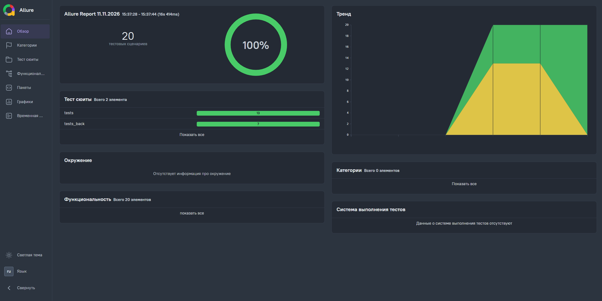

# Автотесты для [Swag Labs / Restful-Booker]

Проект по автоматизации UI и API тестирования веб-сервиса [[Swag Labs](https://www.saucedemo.com/)]. 
В основе фреймворка лежит паттерн **Page Object Model (POM)**.

### 🧰 Используемый стек
* Python 3.10 + Pytest
* Selenium
* Allure Report
* GitHub Actions (CI)

### ✅ Что покрыто тестами
* Авторизация пользователя (позитивные и негативные сценарии).
* Поиск товаров и добавление в корзину (UI).
* CRUD-операции через API (создание, изменение и удаление бронирований).


### 📊 Отчетность (Allure Report)

После каждого коммита тесты автоматически прогоняются в **GitHub Actions** (в headless-режиме), а актуальный отчет публикуется на GitHub Pages:

👉 **[Открыть интерактивный Allure Report](https://karugas.github.io/my_automation_project/)**



---

### 📁 Структура проекта

```text
my_automation_project/
├── .github/workflows/   # Пайплайны GitHub Actions для автозапуска и деплоя отчетов
├── data/                # Тестовые данные и креды пользователей
├── locators/            # Локаторы веб-элементов, разделенные по страницам
├── pages/               # Page Object классы с методами взаимодействия со страницами
├── tests/               # UI автотесты и conftest.py с настройкой браузера
├── tests_back/          # API автотесты и HTTP-клиент
└── requirements.txt     # Зависимости проекта
```

### 🚀 Локальный запуск

1. Клонировать репозиторий:
   ```bash
   git clone https://github.com
   cd my_automation_project
   ```
2. Установить зависимости:
   ```bash
   pip install -r requirements.txt
   ```
3. Запустить все тесты:
   ```bash
   pytest
   ```
4. Запустить UI-тесты в фоновом режиме (без открытия окна браузера):
   ```bash
   pytest --headless
   ```
